<div align="center">

<picture>
  <source media="(prefers-color-scheme: dark)" srcset="public/icons/logo-dark.svg">
  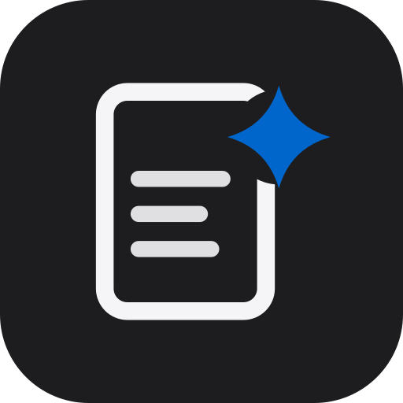
</picture>

# shotrova

**Your screenshots, organized. All findable, all yours.**

Shotrova reads the Turkish and English text in your screenshots on your device, sorts them into categories<br>
and finds them in seconds by what they say. No server, no account, no tracking.

[](https://github.com/firatnexus/shotrova/releases/latest)
[](https://github.com/firatnexus/shotrova/actions/workflows/ci.yml)
[](https://github.com/firatnexus/shotrova/actions/workflows/android.yml)
[](LICENSE)


[**Download the Android APK**](https://github.com/firatnexus/shotrova/releases/latest) &nbsp;·&nbsp;
[**Open the web app**](https://firatnexus.github.io/shotrova/) &nbsp;·&nbsp;
[Release notes](docs/RELEASE_NOTES.md) &nbsp;·&nbsp;
[Test results](docs/TESTING.md)

> The web version is temporarily paused: it stays online at v1.12.2 but is not updated. See [WEB-SUSPENSION.md](WEB-SUSPENSION.md).

<br>

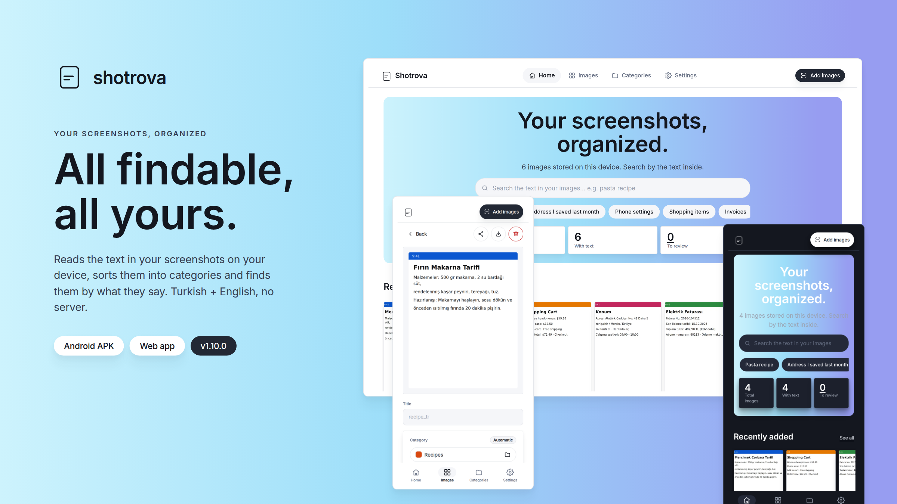

</div>

<br>

## Contents

- [Why Shotrova](#why-shotrova)
- [Screenshots](#screenshots)
- [Features](#features)
- [How it works](#how-it-works)
- [Design language](#design-language)
- [Android app](#android-app)
- [Installation](#installation)
- [Development](#development)
- [Project structure](#project-structure)
- [Test status](#test-status)
- [Limitations](#limitations)
- [Version history](#version-history)
- [License](#license)

## Why Shotrova

Hundreds of screenshots pile up on a phone: a recipe, an invoice, an address, a chat, a settings screen. In the gallery they all look the same, and finding the one you need means scrolling through them one by one. Shotrova turns that pile into a searchable notebook.

| | |
|---|---|
| **Reads on your device** | Real OCR (tesseract.js) runs in the browser or in the app; images are never uploaded to a server. |
| **Organizes itself** | 11 built-in categories, a confidence score and a review queue for images it is unsure about. It learns rules from your corrections. |
| **Finds by text** | Searches like "pasta recipe" or "address I saved last month"; tolerant of Turkish characters, with highlighted matches. |
| **Stays yours** | Data lives in IndexedDB on the device. Backups are ZIP or JSON files you keep. |
| **Two forms, one codebase** | A native Android app (Capacitor) and an installable web app (PWA). |

## Screenshots

<table>
  <tr>
    <td width="25%" align="center">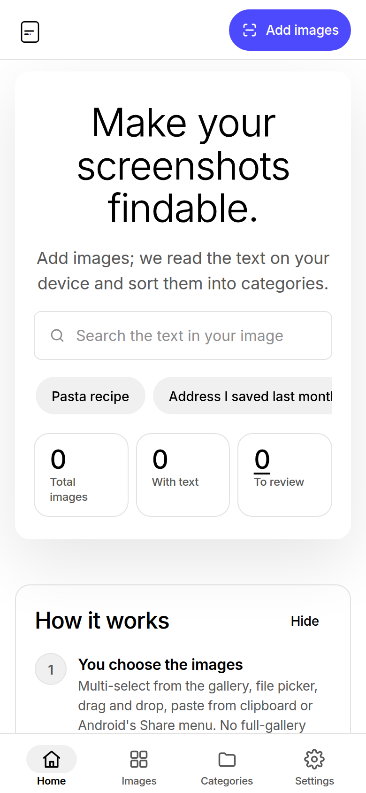<br><sub><b>First launch</b> · light</sub></td>
    <td width="25%" align="center">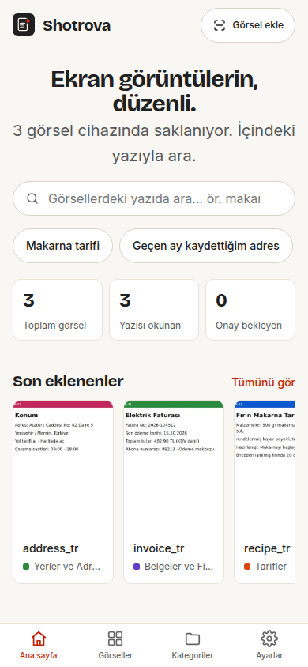<br><sub><b>Home</b> · light</sub></td>
    <td width="25%" align="center">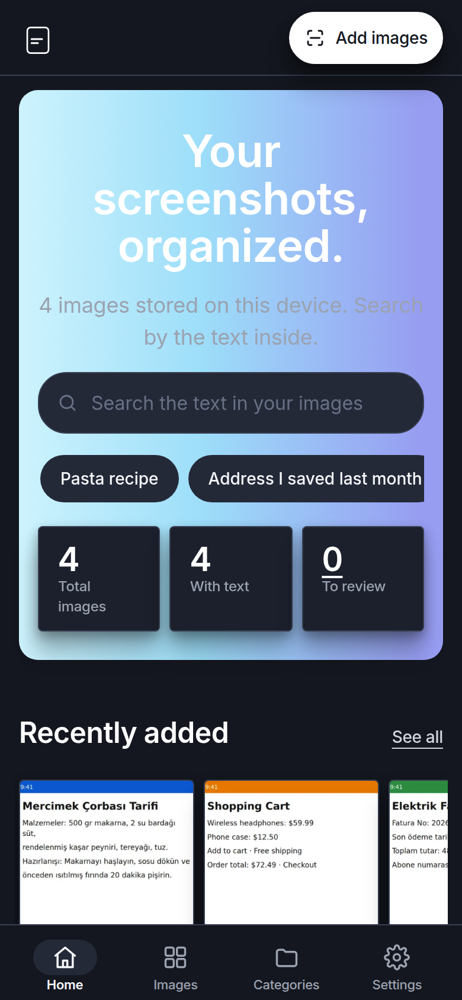<br><sub><b>Home</b> · dark</sub></td>
    <td width="25%" align="center">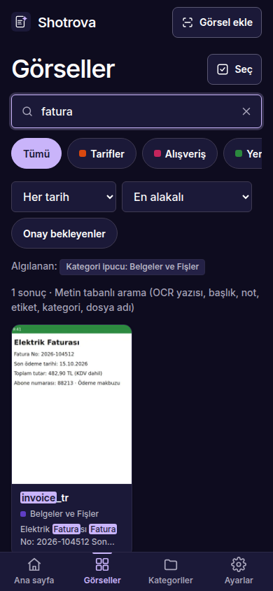<br><sub><b>Search</b> · dark</sub></td>
  </tr>
  <tr>
    <td align="center">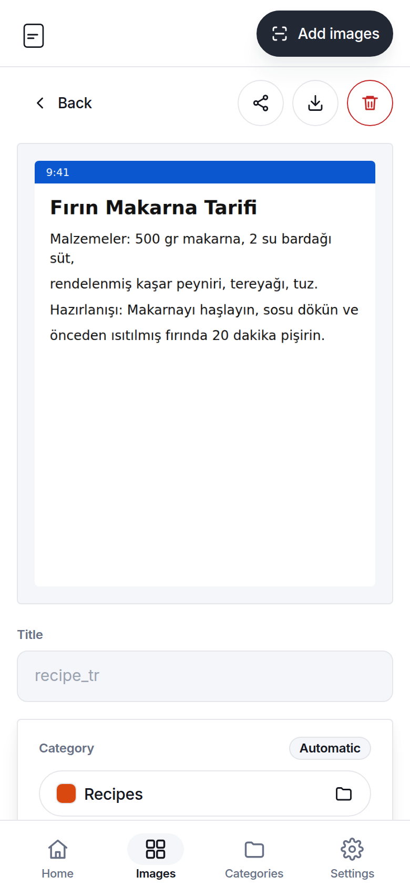<br><sub><b>Image detail</b> · light</sub></td>
    <td align="center">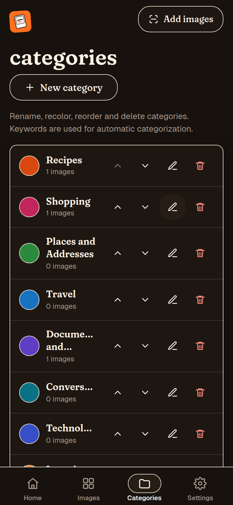<br><sub><b>Categories</b> · dark</sub></td>
    <td align="center">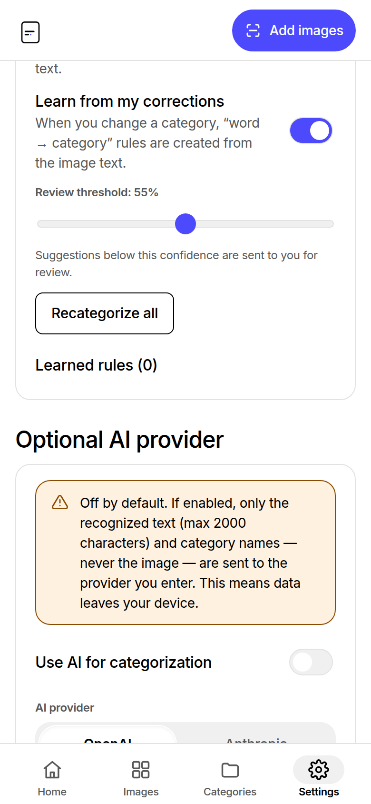<br><sub><b>AI settings</b> · light</sub></td>
    <td align="center">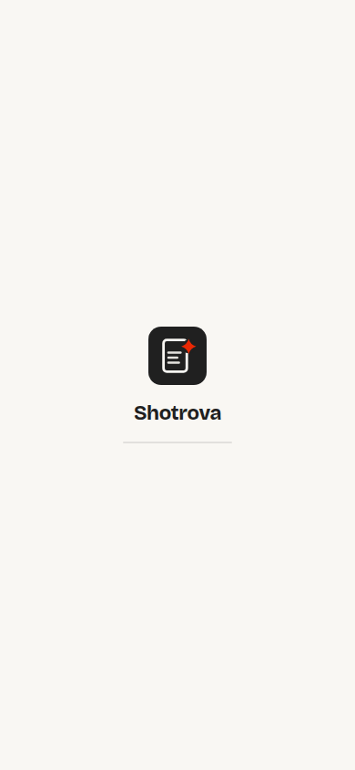<br><sub><b>Splash</b> · light</sub></td>
  </tr>
</table>

<table>
  <tr>
    <td width="33%" align="center">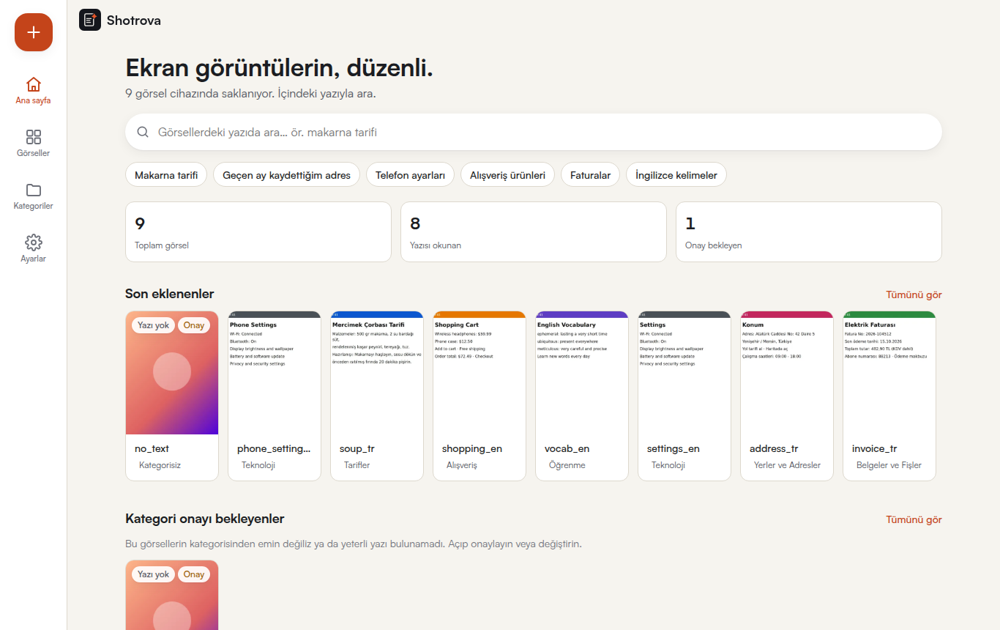<br><sub><b>Desktop</b> · home</sub></td>
    <td width="33%" align="center">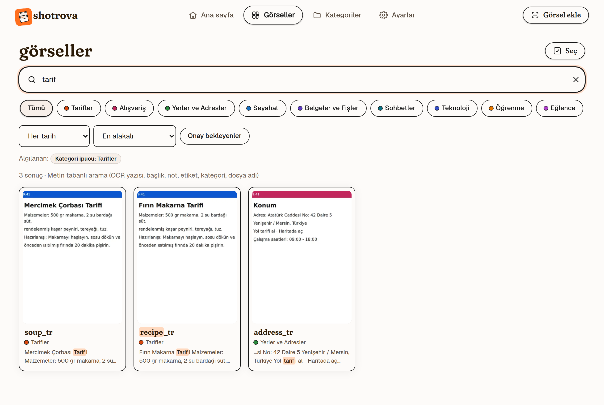<br><sub><b>Desktop</b> · search</sub></td>
    <td width="33%" align="center">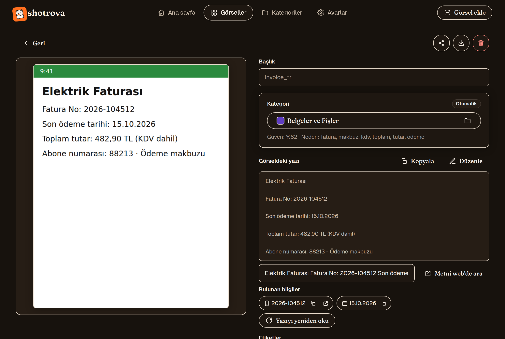<br><sub><b>Desktop</b> · detail, dark</sub></td>
  </tr>
</table>

Screenshots show the English UI. Turkish is the default language and can be switched in Settings.

## Features

### Capture and import

- **Automatic screenshot capture (Android, opt-in):** once enabled, the app detects new screenshots by itself (MediaStore + WorkManager background work, no persistent notification), copies them into its own storage so they survive gallery deletion and, with your explicit consent, analyses them with your own AI key to produce a title and category. Each capture posts a notification like "Saved to Shopping as 'Invoice summary'"; tapping it opens the image.
- **Honest status card:** home shows "Automatic capture: On / Off / Missing permission / Battery restricted" with a one-tap fix for each problem, plus a step-by-step "Background work settings" guide for Xiaomi/HyperOS.
- **Leaves your history alone:** your existing screenshot archive is never imported on first enable; only new screenshots are captured. Partial media access (Android 14+) is supported.
- **Import methods:** multi-select from the system photo picker, file picker, drag and drop, clipboard (Ctrl+V or "Paste from clipboard") and the Android share sheet (**Share → Shotrova**).
- **Safe file handling:** JPEG, PNG and WebP; files are validated by their magic bytes, duplicates are detected with SHA-256, and progress and per-file errors are shown.

### Reading and organizing

- **On-device OCR in 12 languages:** English, Turkish, Spanish, French, German, Portuguese, Italian, Hindi, Arabic, Chinese (Simplified), Japanese and Russian, optionally combined with English. Turkish and English are built in; the other 10 language files are downloaded once on demand (SHA-256 verified) and stay on the device — images are never uploaded. Every image shows its status (queued, processing, done, no text, error), failures can be retried and unchanged images are never processed twice. The recognized text is editable; the original image is never modified. Background analysis of automatic captures on Android uses on-device ML Kit text recognition.
- **Categories:** 11 defaults (Recipes, Shopping, Places and Addresses, Travel, Documents and Receipts, Conversations, Technology, Learning, Entertainment, Games, Uncategorized). Create, rename, recolor, reorder and delete.
- **Automatic categorization:** keyword-based with a confidence score. Suggestions below the threshold go to a review queue; your corrections become **visible, deletable** "word → category" rules.
- **Entities:** links, e-mails, phone numbers and dates found in the text become one-tap chips: copy, open, call. On the Images screen, "Copy text" copies the text of every selected image at once.

### Optional AI

- **Any provider:** OpenAI, Anthropic (Claude), Google Gemini, OpenRouter or your own OpenAI-compatible endpoint. Each provider keeps its own key, model and base URL; keys never end up in backups.
- **Vision off (default):** only the on-device OCR text (up to 2000 characters) and category names are sent; the image never leaves the device.
- **Vision on (explicit opt-in):** the image is sent to the provider and the model extracts a **clean title, category and the full text**. The raw device OCR is stored in a separate field so the two can be compared. You can also ask free-form questions about an image ("what is this?").
- **AI text editor:** "Fix with AI" repairs OCR garbling and formatting, "Add emojis" adds tasteful emojis. Always applied after a preview; manual edits are never overwritten silently.
- **Per-image exclusion:** "Don't send to AI" keeps a single image out of AI entirely.

### Search and privacy

- **Text-based search** (not semantic) over OCR text, title, note, tags, category and file name. Phrases like "last month" and category names become filters; a small TR↔EN synonym table helps across languages.
- **Privacy:** no server, no account, no analytics. Your images, OCR text and everything you do stay in IndexedDB on the device; backups (ZIP with images, or JSON) are files you export yourself. The single exception is the **optional** AI feature you enable with your own key: with image vision off, only the OCR text (≤2000 chars) and category names are sent to your chosen provider; with vision on (explicit opt-in), the image is sent too. ZIP (with images) or JSON backup and validated restore.
- **12 interface languages** with a custom language menu; Arabic uses a full right-to-left layout. Turkish and English are reviewed; the other 10 were machine-assisted.
- **Swipe navigation:** swipe between Home, Images, Categories and Settings (no wrap-around; chips, carousels, dialogs and text fields keep their own gestures).
- **Animated search hint:** 25 example searches typed out in the app language; stops on focus and never touches your input.
- **Accessibility:** full keyboard use, visible focus ring, reduced-motion support, WCAG AA contrast, skeleton loading, empty states, toasts and confirmation dialogs.

## How it works

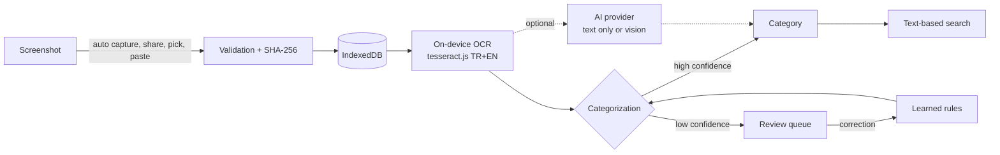

Architecture details: [docs/ARCHITECTURE.md](docs/ARCHITECTURE.md) · User flows: [FLOWS.md](FLOWS.md)

## Design language

Since 1.11.0 Shotrova looks like a **white gallery wall with a single indigo spotlight** (Figma-inspired): a pure white canvas of black text and mist-gray hairlines where the only saturated color is Electric Indigo — reserved for the primary action, links and active states. The interface stays achromatic on purpose; the screenshots are the color.

| Element | Light theme | Dark theme | Used for |
|---|---|---|---|
| Paper | `#ffffff` | `#0a0a0a` | The whole canvas |
| Ink | `#000000` | `#ffffff` | Text, headings, icon strokes |
| Hairline | `#e2e2e2` | `#262626` | Card borders, dividers |
| Mist | `#f0f0f1` | `#141414` | Secondary surfaces, inputs, chips |
| Electric Indigo | `#4d49fc` | `#8f8cff` (links on dark) | The single primary action, links, focus rings |
| Floating shadow | `0 24px 70px` @ 10% black | 50% black | The hero card and overlays only |

- **Typography:** Inter (variable, OFL, bundled offline with full Turkish support) stands in for figmaSans: 16px minimum body size, weight-driven hierarchy — headings at 520, and an ultra-light whisper headline (weight 340, -0.02em tracking) on the home hero.
- **Radii:** a strict four-tier curvature language — 2px fine UI (badges, dividers), 8px ghost buttons and inputs, 16px cards, 50px pill buttons and chips.
- **Components:** the default button is a ghost with a 1px black border; the primary CTA is the one indigo pill per screen (the header's "add screenshots" action); inverse actions are solid black pills. Grid cards are flat white with hairlines — no shadows except the single hero/overlay float.
- **Layout:** left-aligned rhythm; the home hero is a floating white card — the display moment. On desktop a plain text menu centred in the top bar and a 1200px content width; on mobile a labelled bottom tab bar. Home ends with the featured black "add your screenshots" band.
- **Constraints:** one indigo CTA per screen; no illustrations, no colored shadows or glows; vivid color appears only inside cards (category tints) and the indigo accent.
- **Logo:** a minimal two-color mark — a rounded screenshot frame holding two text lines, the second ending in a single indigo dot: "the word you searched for, found inside".

<p>
  
  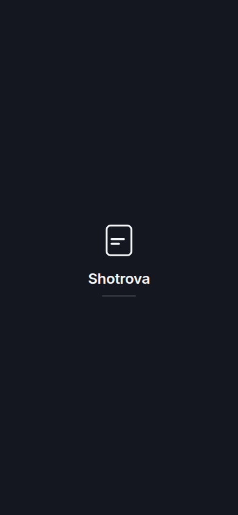
  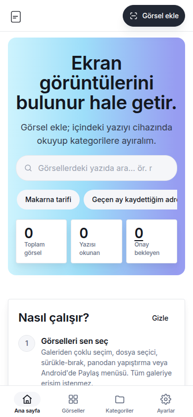
  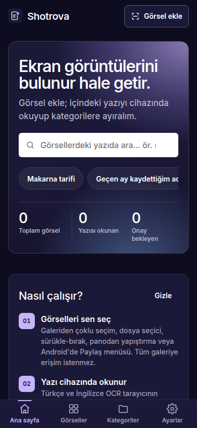
</p>

## Android app

- **Automatic capture:** enabled from the first-run consent screen or Settings → Automatic capture. MediaStore + WorkManager content triggers run as soon as the OS allows background work (seconds on stock Android, possibly delayed by OEM power management), plus a periodic catch-up scan (minimum 15 minutes, an OS floor rather than a real-time promise) and a catch-up on every launch for anything missed. Failed analyses are honestly queued as "Analysis pending" and retried.
- **Share sheet:** **Share → Shotrova** for one or many images from the gallery, Files or any app that shares images.
- **Save as:** "Download" (the original image) and the backup exports ("Full backup (ZIP)", "Data only (JSON)") open the Android **Save as** dialog (Storage Access Framework).
- **Also delete from phone:** deleting inside the app removes only the app's copy; once you confirm, the system delete flow also removes the gallery original (Android 11+).
- **Native feel:** pinch zoom disabled, a real splash screen, status and navigation bars that follow the theme; the back button closes dialogs first, then walks back through the app, then leaves it.
- **Key security:** the AI key is stored on the device encrypted with Android Keystore.

### Permissions

| Permission | When | Why |
|---|---|---|
| `INTERNET` | Always | Only for the optional AI provider and "Search this text on the web" |
| `READ_MEDIA_IMAGES` / `READ_MEDIA_VISUAL_USER_SELECTED` (Android 13+, partial access on 14+) | If automatic capture is on | Detecting new screenshots |
| `READ_EXTERNAL_STORAGE` (Android 8–12, `maxSdkVersion 32`) | If automatic capture is on | Same purpose on older versions |
| `POST_NOTIFICATIONS` | If automatic capture is on | A notification for each saved screenshot |
| `RECEIVE_BOOT_COMPLETED`, `WAKE_LOCK` | If automatic capture is on | Re-arming the capture work after a reboot (WorkManager) |

Location, camera, microphone or contacts permissions are never requested. Android cloud backup is disabled (`allowBackup="false"`); use the in-app backup.

## Installation

### Android

1. Download `shotrova-<version>.apk` to your phone from the [latest release](https://github.com/firatnexus/shotrova/releases/latest) (signed release build, Android 8.0+ / API 26+).
2. Optionally verify the file against `SHA256SUMS.txt` on the same page.
3. Open the APK; if Android asks, allow "Install unknown apps" for your browser or file manager.
4. On first launch, enabling automatic capture is up to you.

The app is not on Google Play.

### Web

Open [firatnexus.github.io/shotrova](https://firatnexus.github.io/shotrova/) in a modern browser; add it to your home screen from the browser menu to use it like an app.

## Development

Requirements: Node.js 20+; for the APK, JDK 21 and Android SDK 35.

```bash
npm ci --legacy-peer-deps
npm run dev                         # development server
npm run build && npm run preview    # production build → http://localhost:4173
npm test                            # unit tests (Vitest)
npm run test:ocr                    # real tesseract recognition in all 12 OCR languages
npm run test:e2e                    # Playwright end-to-end tests (build first)
npm run icons                       # generate logo, favicon, PWA and Android icons
npm run apk:debug                   # build + cap sync + gradlew assembleDebug
```

Signing, CI and release details: [docs/DEPLOY.md](docs/DEPLOY.md). Pushing a `v*` tag makes the Android workflow build the signed APK and `SHA256SUMS.txt` and publish them on a release page that shows only that version's notes.

## Project structure

```text
src/
  ai/           providers (OpenAI, Anthropic, Gemini, OpenRouter, custom) and vision
  auto/         automatic capture sync
  backup/       ZIP / JSON backup and validated restore
  categorize/   keyword categorizer, learned rules, AI
  config/       brand: name, version, colors, logo SVG
  db/           IndexedDB schema (idb)
  i18n/         12 language files (tr, en, es, fr, de, pt, it, hi, ar, zh, ja, ru)
  import/       file validation and image processing
  lib/          actions, entity extraction, state, toasts
  native/       Capacitor bridge
  ocr/          tesseract.js engine, job queue and OCR languages (built into the APK, on-demand on the web)
  search/       text-based search and query parsing
  ui/           React screens, styles.css, stickers
android/        Capacitor Android project (Java: capture, sharing, SAF)
public/         icons, fonts, OCR language files, manifest
scripts/        icon, screenshot and README image generators
tests/          unit, web E2E and APK web-shell E2E tests
docs/           architecture, testing, deployment, name research, screenshots
```

## Test status

| Suite | Result |
|---|---|
| Unit tests (Vitest) | 126 / 126 |
| Real OCR recognition, 12 languages + combined (`npm run test:ocr`) | 13 / 13 |
| Web E2E, root path (Playwright, Pixel 7 + desktop Chromium) | 52 passed, 2 skipped (mobile-only on desktop) |
| Web E2E, `/shotrova/` subpath (GitHub Pages layout) | runs in CI on every push |
| APK web-shell E2E (simulated Android bridge) | runs against the real built APK in the Android workflow |
| TypeScript (`tsc -b`) and subpath build | clean |

Every result was actually executed; logs and manual test steps are in [docs/TESTING.md](docs/TESTING.md).

## Limitations

- **Not tested on a physical Android device or emulator.** The build environment has no KVM/emulator. The APK is built, signed and its bundled web files are tested in Chromium with a simulated Android bridge, but the Java side (sharing, Save as, background capture timing, especially on Xiaomi/HyperOS with the screen off) can only be verified on a real device.
- **Background timing is not guaranteed:** force-stop, reboot and OEM battery savers can delay detection.
- **Storage is not permanent:** uninstalling the app or clearing its data (browser data for the web version) deletes everything. Make regular backups.
- **OCR accuracy** depends on image quality; handwriting and very small or decorative text may be misread. The web version downloads about 17 MB of OCR files on first use; the APK bundles Turkish and English. The other 10 OCR languages need a one-time download (0.7–2.7 MB each). Vertical Japanese and Traditional Chinese are not supported, and background analysis of automatic captures (ML Kit) reads Latin script only.
- **Translations:** languages other than Turkish and English were machine-assisted and need native review. Date phrases in search ("last month") and the keyword categorizer understand Turkish and English only.
- **Visual understanding is optional:** without AI, categorization relies only on recognized text; photos without text go to "Uncategorized" for review.
- **Search is text-based,** not semantic.
- **Android only:** there is no iOS build. On the web, the share target works only after installing the PWA in a Chromium-based Android browser.
- **No legal guarantee for the name.** See [docs/NAMING.md](docs/NAMING.md).

## Version history

| Version | Highlights |
|---|---|
| **1.12.3** | All 12 OCR languages built into the APK, so there are no downloads and no dependency on the web version |
| 1.12.2 | Attached date and sort menus on the Images screen, redesigned launch screen with a seamless Android splash hand-off |
| 1.12.1 | Smoother tab swiping (finger-tracking pages, continuous slide-in, no Images stall), swipes allowed over menus and idle fields |
| 1.12.0 | Animated search hint (25 examples), keyboard-safe sheets on Android 15, 12 UI languages with Arabic RTL, 12 offline OCR languages via verified on-demand packs, swipe between tabs |
| 1.11.0 | Figma-inspired "white gallery wall" redesign: pure white canvas, ink & mist system, Electric Indigo single CTA, whisper-weight hero, four-tier radii, spark-dot logo |
| 1.10.0 | Contra-inspired "editorial gallery" redesign: white paper canvas, ink & hairline system, charcoal pill actions, Inter, hero gradient wash, new frame logo |
| 1.9.1 | English README, release notes and screenshots; "1 result" wording fix |
| 1.9.0 | Superr-inspired "school notebook" design, orange polaroid logo, bundled Fraunces + Geist |
| 1.8.0 | Threads-inspired minimal design, black-and-white polaroid logo |
| 1.7.0 | Portrait-inspired design, new polaroid logo |
| 1.6.0 | Superhuman-inspired design, double splash fix, dark native splash |
| 1.5.0 | Apple-inspired visual language |
| 1.4.0 | Automatic screenshot capture, status card, Also delete from phone, HyperOS guide |
| 1.3.x | Multi-provider AI, image Q&A, web search for recognized text |
| 1.2.x | AI vision, text editor, entity chips, splash screen |

Full details: [docs/RELEASE_NOTES.md](docs/RELEASE_NOTES.md)

## License

MIT, see [LICENSE](LICENSE).

Third-party components: [tesseract.js](https://github.com/naptha/tesseract.js) (Apache-2.0), Tesseract language models `@tesseract.js-data/tur` and `eng` (Apache-2.0 / MIT), [Capacitor](https://capacitorjs.com/) (MIT), [React](https://react.dev/) (MIT), [idb](https://github.com/jakearchibald/idb) (ISC), [fflate](https://github.com/101arrowz/fflate) (MIT), [Google ML Kit Text Recognition](https://developers.google.com/ml-kit/vision/text-recognition/v2/android) (Android only, [ML Kit terms](https://developers.google.com/ml-kit/terms)), [Inter](https://github.com/rsms/inter) (SIL Open Font License 1.1, license text in `public/fonts/OFL-Inter.txt`).

<div align="center">
<br>
<sub>shotrova · an editorial wall for your screenshots</sub>
</div>
