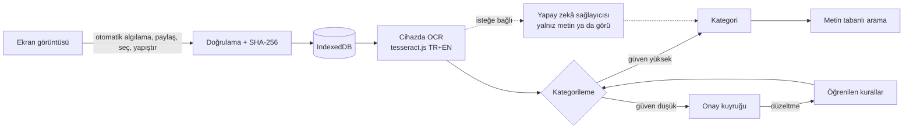

<div align="center">


# shotrova

**Ekran görüntülerin, düzenli. Hepsi bulunur, hepsi sende.**

Ekran görüntülerindeki Türkçe ve İngilizce yazıyı cihazında okur, kategorilere ayırır<br>
ve içindeki yazıyla saniyeler içinde bulmanı sağlar. Sunucu yok, hesap yok, takip yok.

[](https://github.com/firatnexus/shotrova/releases/latest)
[](https://github.com/firatnexus/shotrova/actions/workflows/ci.yml)
[](https://github.com/firatnexus/shotrova/actions/workflows/android.yml)
[](LICENSE)


[**Android APK'yı indir**](https://github.com/firatnexus/shotrova/releases/latest) &nbsp;·&nbsp;
[**Web uygulamasını aç**](https://firatnexus.github.io/shotrova/) &nbsp;·&nbsp;
[Sürüm notları](docs/RELEASE_NOTES.md) &nbsp;·&nbsp;
[Test sonuçları](docs/TESTING.md)

<br>


</div>

<br>

## İçindekiler

- [Neden Shotrova](#neden-shotrova)
- [Ekran görüntüleri](#ekran-görüntüleri)
- [Özellikler](#özellikler)
- [Nasıl çalışır](#nasıl-çalışır)
- [Tasarım dili](#tasarım-dili)
- [Android uygulaması](#android-uygulaması)
- [Kurulum](#kurulum)
- [Geliştirme](#geliştirme)
- [Proje yapısı](#proje-yapısı)
- [Test durumu](#test-durumu)
- [Sınırlamalar](#sınırlamalar)
- [Sürüm geçmişi](#sürüm-geçmişi)
- [Lisans](#lisans)

## Neden Shotrova

Telefonda yüzlerce ekran görüntüsü birikir: bir tarif, bir fatura, bir adres, bir sohbet, bir ayar ekranı. Galeride hepsi aynı görünür ve aradığını bulmak için tek tek kaydırırsın. Shotrova bu birikintiyi aranabilir bir defter hâline getirir.

| | |
|---|---|
| **Cihazında okur** | Gerçek OCR (tesseract.js) tarayıcıda ya da uygulamada çalışır; görsel hiçbir sunucuya yüklenmez. |
| **Kendiliğinden düzenler** | 11 hazır kategori, güven puanı ve emin olmadığı görseller için onay kuyruğu. Düzeltmelerinden kural öğrenir. |
| **Yazıyla bulur** | "makarna tarifi", "geçen ay kaydettiğim adres" gibi aramalar; Türkçe karakterlere toleranslı, eşleşmeler vurgulu. |
| **Senin kalır** | Veriler cihazdaki IndexedDB'de durur. Yedekleme ZIP ya da JSON olarak senin elinde. |
| **İki biçim, tek kod** | Yerel Android uygulaması (Capacitor) ve ana ekrana eklenebilen web uygulaması (PWA). |

## Ekran görüntüleri

<table>
  <tr>
    <td width="25%" align="center"><br><sub><b>İlk açılış</b> · açık</sub></td>
    <td width="25%" align="center"><br><sub><b>Ana ekran</b> · açık</sub></td>
    <td width="25%" align="center"><br><sub><b>Ana ekran</b> · koyu</sub></td>
    <td width="25%" align="center"><br><sub><b>Arama</b> · koyu</sub></td>
  </tr>
  <tr>
    <td align="center"><br><sub><b>Görsel detayı</b> · açık</sub></td>
    <td align="center"><br><sub><b>Kategoriler</b> · koyu</sub></td>
    <td align="center"><br><sub><b>Yapay zekâ ayarları</b> · açık</sub></td>
    <td align="center"><br><sub><b>Açılış ekranı</b> · açık</sub></td>
  </tr>
</table>

<table>
  <tr>
    <td width="33%" align="center"><br><sub><b>Masaüstü</b> · ana ekran</sub></td>
    <td width="33%" align="center"><br><sub><b>Masaüstü</b> · arama</sub></td>
    <td width="33%" align="center"><br><sub><b>Masaüstü</b> · detay, koyu</sub></td>
  </tr>
</table>

## Özellikler

### Yakalama ve içe aktarma

- **Otomatik ekran görüntüsü algılama (Android, isteğe bağlı):** açtığında uygulama yeni ekran görüntülerini kendisi algılar (MediaStore + WorkManager arka plan işi, sürekli bildirim yok), galeriden silinse bile kalsın diye kendi depolamasına kopyalar ve açık onayınla kendi yapay zekâ anahtarınla analiz edip başlık ve kategori üretir. Her kayıt için "Ekran görüntüsü 'Fatura Özeti' başlığıyla Alışveriş kategorisine kaydedildi" gibi bir bildirim gelir; dokununca görsel açılır.
- **Dürüst durum kartı:** ana ekranda "Otomatik algılama: Açık / Kapalı / İzin eksik / Pil kısıtı var" ve her sorun için tek dokunuşla çözüm. Xiaomi/HyperOS için adım adım "Arka plan çalışma ayarları" rehberi.
- **Geçmişe dokunmaz:** ilk açılışta eski ekran görüntüsü arşivin içe aktarılmaz; yalnızca yeni görüntüler yakalanır. Kısmi medya erişimi (Android 14+) desteklenir.
- **İçe aktarma yolları:** sistem fotoğraf seçicisinden çoklu seçim, dosya seçici, sürükle-bırak, pano (Ctrl+V ya da "Panodan yapıştır") ve Android paylaşım menüsü (**Paylaş → Shotrova**).
- **Güvenli dosya işleme:** JPEG, PNG ve WebP; dosyalar sihirli baytlarıyla doğrulanır, kopyalar SHA-256 ile ayıklanır, ilerleme ve dosya başına hata gösterilir.

### Okuma ve düzenleme

- **Cihaz üzerinde OCR:** Türkçe + İngilizce. Her görselin durumu görünür (sırada, işleniyor, tamam, yazı yok, hata), hatalar yeniden denenebilir, değişmeyen görsel iki kez işlenmez. Okunan yazı düzenlenebilir; orijinal görsele asla dokunulmaz.
- **Kategoriler:** 11 varsayılan kategori (Tarifler, Alışveriş, Yerler ve Adresler, Seyahat, Belgeler ve Fişler, Sohbetler, Teknoloji, Öğrenme, Eğlence, Oyunlar, Kategorisiz). Oluştur, yeniden adlandır, renklendir, sırala, sil.
- **Otomatik kategorileme:** anahtar kelime tabanlı, güven puanlı. Eşiğin altındaki öneriler onay kuyruğuna düşer; düzeltmelerin **görünür ve silinebilir** "kelime → kategori" kurallarına dönüşür.
- **Bulunan bilgiler:** yazıdaki bağlantı, e-posta, telefon numarası ve tarihler tek dokunuşluk çiplere dönüşür: kopyala, aç, ara. Görseller ekranında "Metni kopyala" seçili tüm görsellerin yazısını birden kopyalar.

### İsteğe bağlı yapay zekâ

- **İstediğin sağlayıcı:** OpenAI, Anthropic (Claude), Google Gemini, OpenRouter ya da kendi OpenAI uyumlu uç noktan. Her sağlayıcı kendi anahtarını, modelini ve adresini ayrı tutar; anahtarlar yedeklere asla girmez.
- **Görü kapalıyken (varsayılan):** yalnızca cihazda okunan yazı (en fazla 2000 karakter) ve kategori adları gönderilir; görselin kendisi cihazdan çıkmaz.
- **Görü açıkken (açık onayla):** görsel sağlayıcıya gönderilir ve model **temiz bir başlık, kategori ve tam metin** çıkarır. Ham cihaz OCR'ı ayrı alanda saklanır, karşılaştırılabilir. Görsel hakkında serbest soru da sorabilirsin ("bu ne?").
- **Yapay zekâ metin düzenleyici:** "temizle" OCR bozukluklarını ve biçimi düzeltir, "emoji" ölçülü emoji ekler. Her zaman önizlemeyle uygulanır; elle yaptığın düzeltmelerin sessizce ezilmez.
- **Görsel başına dışlama:** "Yapay zekaya gönderme" ile tek bir görseli tamamen dışarıda bırakabilirsin.

### Arama ve gizlilik

- **Metin tabanlı arama** (anlamsal değil): OCR yazısı, başlık, not, etiket, kategori ve dosya adı üzerinde. "geçen ay" gibi ifadeler ve kategori adları filtreye dönüşür; küçük bir TR↔EN eş anlamlı tablosu vardır.
- **Gizlilik:** sunucu yok, hesap yok, analitik yok. Her şey cihazdaki IndexedDB'de. Görselli ZIP ya da JSON yedek ve doğrulanmış geri yükleme.
- **Diller:** Türkçe (varsayılan) ve İngilizce.
- **Erişilebilirlik:** klavyeyle tam kullanım, görünür odak halkası, azaltılmış hareket desteği, WCAG AA kontrast, iskelet yükleme, boş durumlar, bildirimler ve onay pencereleri.

## Nasıl çalışır



Mimari ayrıntılar: [docs/ARCHITECTURE.md](docs/ARCHITECTURE.md) · Kullanıcı akışları: [FLOWS.md](FLOWS.md)

## Tasarım dili

1.9.0 ile Shotrova, öğleden sonra ışığında **sıcak bir okul defteri** gibi görünüyor: krem kâğıt, kömür mürekkebi, tek bir turuncu keçeli kalem ve kenarlara yapıştırılmış birkaç çıkartma.

| Öğe | Açık tema | Koyu tema | Kullanım |
|---|---|---|---|
| Kâğıt | `#fdfbf9` | `#17120d` | Tüm zemin |
| Mürekkep | `#171717` | `#f6efe7` | Çizgiler, düğme çerçeveleri, kenarlar |
| Kakao | `#2b1a07` | `#f6efe7` | Büyük başlıklar |
| Keçeli kalem | `#ff6f1e` | `#ff6f1e` | Yalnızca el yazısı notlar, vurgulu kelime, alt bant |
| Çiy damlası | `#f7efe9` | `#1e1711` | Seçili sekme, yumuşak yüzeyler |
| Çıkartmalar | `#3b82f6` · `#ff66cf` · `#22c55e` | aynı | Yalnızca süsleme |

- **Tipografi:** başlıklar ve düğmeler için Fraunces (SOFT eksenli yuvarlak serif, küçük harf), arayüz metinleri için Geist. İkisi de değişken, OFL lisanslı ve uygulamayla birlikte paketlenir; çevrimdışı da aynı görünür.
- **Bileşenler:** krem dolgulu, 1.5px mürekkep çerçeveli, 20px yuvarlak hap düğmeler; dolgulu birincil düğme yok. 12px kartlar, 8px giriş alanları, polaroid görsel kartları.
- **Düzen:** sola hizalı, cömert boşluklu. Masaüstünde üst çubuğun ortasında sade metin menüsü ve 1200px içerik genişliği; mobilde etiketli alt sekme çubuğu. Ana ekranın sonunda 56px üst köşe yarıçaplı turuncu "ekran görüntülerini ekle" bandı.
- **Sınırlar:** geçiş (gradient), cam efekti ve neon yok; kart gölgeleri en fazla 0.06 opaklıkta.
- **Logo:** turuncu kare üzerinde, mürekkeple çizilmiş hafif eğik krem bir polaroid; ikinci yazı satırı turuncu, yani vurgulanmış bir kelime.

<p>
  
  
  
  
</p>

## Android uygulaması

- **Otomatik yakalama:** ilk açılıştaki onay ekranından ya da Ayarlar → Otomatik Algılama'dan açılır. MediaStore + WorkManager içerik tetikleyicileri işletim sistemi izin verdiği anda çalışır (saf Android'de saniyeler, üretici pil yönetimiyle gecikebilir); ayrıca en az 15 dakikalık periyodik tarama (bu bir işletim sistemi alt sınırıdır, gerçek zaman vaadi değil) ve her açılışta kaçırılanları yakalayan tarama vardır. Başarısız analizler dürüstçe "Analiz bekliyor" olarak sıraya alınır ve yeniden denenir.
- **Paylaşım menüsü:** galeriden, Dosyalar'dan ya da görsel paylaşan herhangi bir uygulamadan bir veya birden çok görsel için **Paylaş → Shotrova**.
- **Farklı kaydet:** "Orijinali kaydet" ve "Yedeği dışa aktar" Android'in **Farklı kaydet** penceresini (Storage Access Framework) açar.
- **Telefondan da sil:** uygulama içinde silmek yalnızca uygulamadaki kopyayı siler; onaylarsan sistem silme akışıyla galerideki orijinal de silinir (Android 11+).
- **Yerel his:** yakınlaştırma kapalı, gerçek açılış ekranı, temayı izleyen durum ve gezinme çubukları; geri tuşu önce pencereleri kapatır, sonra uygulamada geri gider, en son uygulamadan çıkar.
- **Anahtar güvenliği:** yapay zekâ anahtarı Android Keystore ile şifrelenmiş olarak cihazda saklanır.

### İzinler

| İzin | Ne zaman | Neden |
|---|---|---|
| `INTERNET` | Her zaman | Yalnızca isteğe bağlı yapay zekâ sağlayıcısı ve "Metni web'de ara" için |
| `READ_MEDIA_IMAGES` (Android 13+, 14+'ta kısmi erişim) | Otomatik yakalama açıksa | Yeni ekran görüntülerini algılamak |
| `READ_EXTERNAL_STORAGE` (Android 8–12, `maxSdkVersion 32`) | Otomatik yakalama açıksa | Eski sürümlerde aynı amaç |
| `POST_NOTIFICATIONS` | Otomatik yakalama açıksa | Kaydedilen her görüntü için bildirim |
| `RECEIVE_BOOT_COMPLETED` | Otomatik yakalama açıksa | Yeniden başlatmadan sonra yakalama işini yeniden kurmak |

`WAKE_LOCK` arka plan işi (WorkManager) için eklenir. Konum, kamera, mikrofon ya da kişiler izni hiçbir zaman istenmez. Android bulut yedeği kapalıdır (`allowBackup="false"`); uygulama içi yedeklemeyi kullan.

## Kurulum

### Android

1. [Son sürüm sayfasından](https://github.com/firatnexus/shotrova/releases/latest) `shotrova-<sürüm>.apk` dosyasını telefona indir (imzalı sürüm derlemesi, Android 8.0+ / API 26+).
2. İstersen aynı sayfadaki `SHA256SUMS.txt` ile dosyayı doğrula.
3. APK'yı aç; Android sorarsa tarayıcın ya da dosya yöneticin için "Bilinmeyen uygulamaları yükle" iznini ver.
4. İlk açılışta otomatik yakalamayı açmak ya da atlamak sana kalmış.

Uygulama Google Play'de değildir.

### Web

[firatnexus.github.io/shotrova](https://firatnexus.github.io/shotrova/) adresini modern bir tarayıcıda aç; tarayıcı menüsünden ana ekrana ekleyerek uygulama gibi kullanabilirsin.

## Geliştirme

Gereksinimler: Node.js 20+, APK için JDK 21 ve Android SDK 35.

```bash
npm ci --legacy-peer-deps
npm run dev                         # geliştirme sunucusu
npm run build && npm run preview    # üretim derlemesi → http://localhost:4173
npm test                            # birim testleri (Vitest)
npm run test:e2e                    # Playwright uçtan uca testleri (önce build)
npm run icons                       # logo, favicon, PWA ve Android simgelerini üret
npm run apk:debug                   # build + cap sync + gradlew assembleDebug
```

İmzalama, CI ve yayın ayrıntıları: [docs/DEPLOY.md](docs/DEPLOY.md). `v*` etiketi gönderildiğinde Android iş akışı imzalı APK'yı ve `SHA256SUMS.txt` dosyasını derleyip sürüm notlarıyla birlikte yayınlar.

## Proje yapısı

```text
src/
  ai/           sağlayıcılar (OpenAI, Anthropic, Gemini, OpenRouter, özel) ve görü
  auto/         otomatik yakalama senkronizasyonu
  backup/       ZIP / JSON yedekleme ve doğrulanmış geri yükleme
  categorize/   anahtar kelime kategorileyici, öğrenilen kurallar, yapay zekâ
  config/       marka: ad, sürüm, renkler, logo SVG'si
  db/           IndexedDB şeması (idb)
  i18n/         tr.json, en.json
  import/       dosya doğrulama ve görsel işleme
  lib/          eylemler, varlık çıkarma, durum, bildirimler
  native/       Capacitor köprüsü
  ocr/          tesseract.js iş kuyruğu
  search/       metin tabanlı arama ve sorgu ayrıştırma
  ui/           React ekranları, styles.css, çıkartmalar
android/        Capacitor Android projesi (Java: yakalama, paylaşım, SAF)
public/         simgeler, fontlar, OCR dil dosyaları, manifest
scripts/        simge, ekran görüntüsü ve README görseli üreticileri
tests/          birim, web E2E ve APK web kabuğu E2E testleri
docs/           mimari, test, yayın, ad araştırması, ekran görüntüleri
```

## Test durumu

| Paket | Sonuç |
|---|---|
| Birim testleri (Vitest) | 83 / 83 |
| Web E2E, kök yol (Playwright, masaüstü Chromium) | 38 / 38 |
| APK web kabuğu E2E (simüle Android köprüsü, yerel) | 10 / 11; A1 gerçek APK'daki paketli OCR dosyalarını ister ve Android iş akışında çalışır |
| TypeScript (`tsc -b`) ve alt yol derlemesi (`/shotrova/`) | temiz |

Tüm sonuçlar gerçekten çalıştırılmıştır; kayıtlar ve elle test adımları [docs/TESTING.md](docs/TESTING.md) içinde.

## Sınırlamalar

- **Fiziksel Android cihazda ya da emülatörde test edilmedi.** Derleme ortamında KVM/emülatör yok. APK derlenip imzalanıyor ve paketlenmiş web dosyaları simüle bir Android köprüsüyle Chromium'da test ediliyor; ancak Java tarafı (paylaşım, Farklı kaydet, arka plan yakalama zamanlaması, özellikle Xiaomi/HyperOS'ta ekran kapalıyken) yalnızca gerçek cihazda doğrulanabilir.
- **Arka plan zamanlaması garanti değil:** zorla durdurma, yeniden başlatma ve üretici pil tasarrufu algılamayı geciktirebilir.
- **Depolama kalıcı değil:** uygulamayı kaldırmak ya da verilerini (web'de tarayıcı verilerini) temizlemek her şeyi siler. Düzenli yedek al.
- **OCR doğruluğu** görsel kalitesine bağlıdır; el yazısı, çok küçük ya da süslü yazılar yanlış okunabilir. Web sürümü ilk kullanımda yaklaşık 17 MB OCR dosyası indirir; APK bunları içinde taşır.
- **Görsel anlama isteğe bağlıdır:** yapay zekâ olmadan kategorileme yalnızca okunan yazıya dayanır; yazısız fotoğraflar onay için "Kategorisiz"e düşer.
- **Arama metin tabanlıdır,** anlamsal değildir.
- **Yalnızca Android:** iOS derlemesi yok. Web'de paylaşım hedefi yalnızca PWA, Chromium tabanlı bir Android tarayıcıya kurulduğunda çalışır.
- **Ad için hukuki garanti yok.** Bkz. [docs/NAMING.md](docs/NAMING.md).

## Sürüm geçmişi

| Sürüm | Öne çıkan |
|---|---|
| **1.9.0** | Superr esintili "okul defteri" tasarımı, turuncu polaroid logo, paketlenmiş Fraunces + Geist, yeni README ve ekran görüntüleri |
| 1.8.0 | Threads esintili sade tasarım, siyah-beyaz polaroid logo |
| 1.7.0 | Portrait esintili tasarım, yeni polaroid logo |
| 1.6.0 | Superhuman esintili tasarım, çift açılış ekranı düzeltmesi, koyu yerel açılış |
| 1.5.0 | Apple esintili arayüz dili |
| 1.4.0 | Otomatik ekran görüntüsü algılama, durum kartı, Telefondan da sil, HyperOS rehberi |
| 1.3.x | Çoklu yapay zekâ sağlayıcısı, görsel hakkında soru-cevap, Metni web'de ara |
| 1.2.x | Yapay zekâ görü, metin düzenleyici, bulunan bilgi çipleri, açılış ekranı |

Tüm ayrıntılar: [docs/RELEASE_NOTES.md](docs/RELEASE_NOTES.md)

## Lisans

MIT, bkz. [LICENSE](LICENSE).

Üçüncü taraf bileşenler: [tesseract.js](https://github.com/naptha/tesseract.js) (Apache-2.0), Tesseract dil modelleri `@tesseract.js-data/tur` ve `eng` (Apache-2.0 / MIT), [Capacitor](https://capacitorjs.com/) (MIT), [React](https://react.dev/) (MIT), [idb](https://github.com/jakearchibald/idb) (ISC), [fflate](https://github.com/101arrowz/fflate) (MIT), [Fraunces](https://github.com/undercasetype/Fraunces) ve [Geist](https://github.com/vercel/geist-font) (SIL Open Font License 1.1, lisans metinleri `public/fonts/` içinde).

<div align="center">
<br>
<sub>shotrova · ekran görüntülerin için sevgiyle tutulmuş bir defter</sub>
</div>
