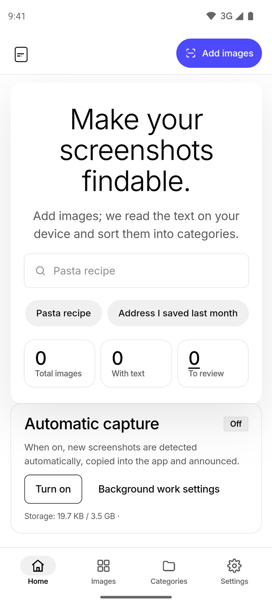
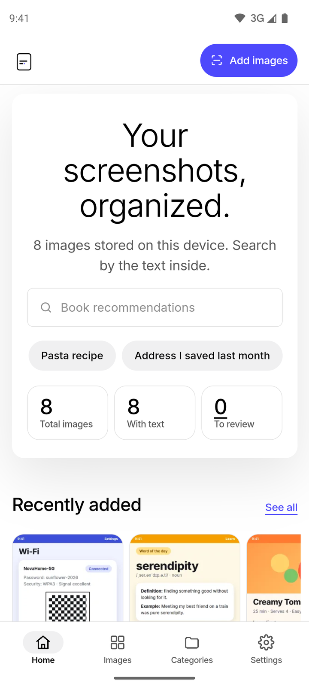
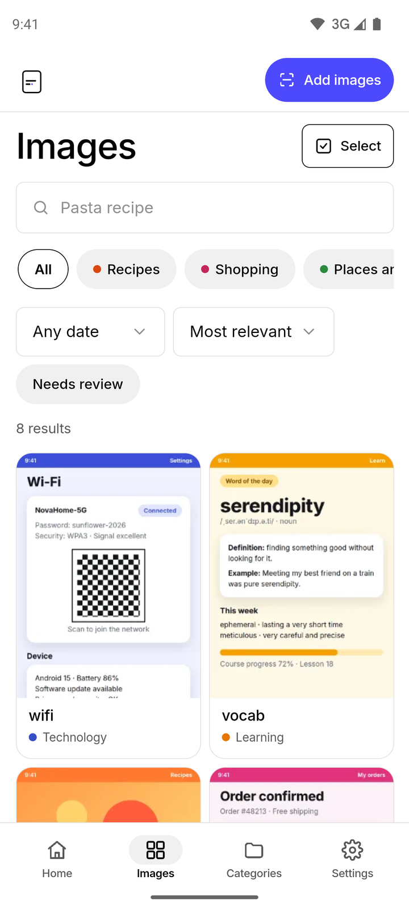
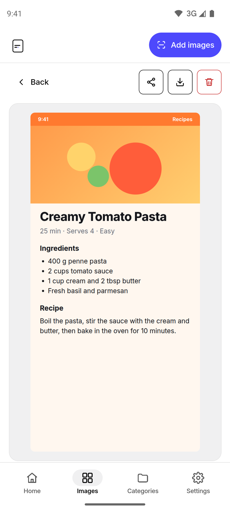
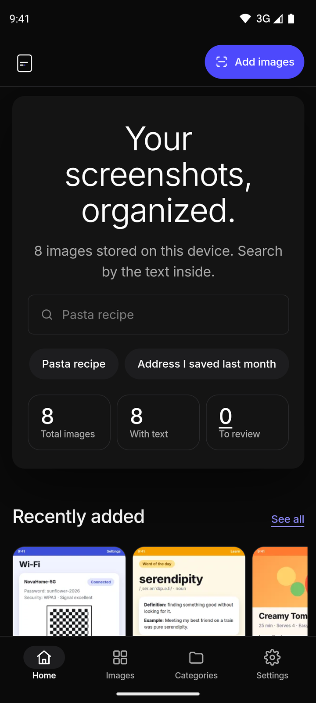
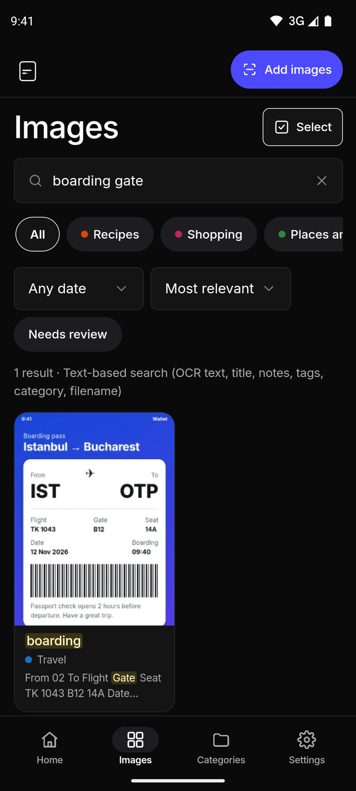
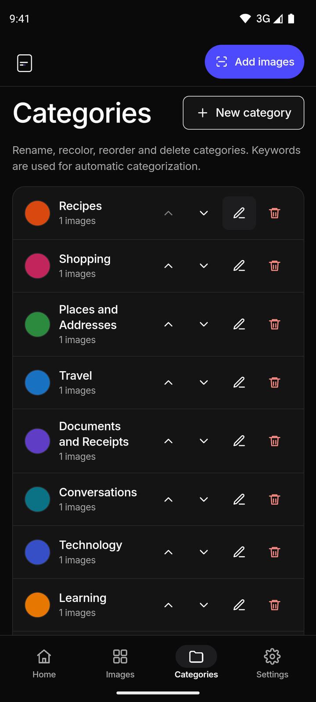
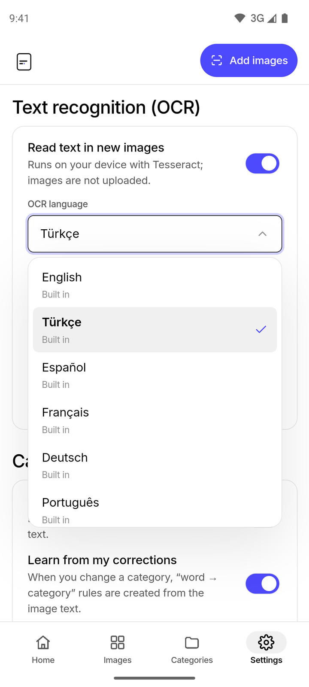
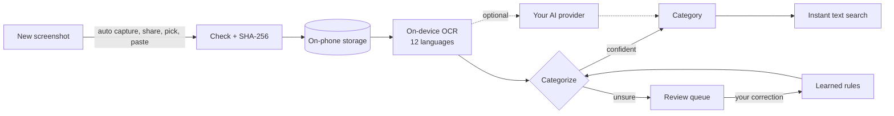

<div align="center">

<picture>
  <source media="(prefers-color-scheme: dark)" srcset="public/icons/logo-dark.svg">
  
</picture>

# Shotrova

### Every screenshot, found in a second.

**Snap it, forget it, find it.** Shotrova reads the text in your screenshots right on your phone,<br>
files each one into the right category and brings it back the moment you type what it said.<br>
Recipes, boarding passes, Wi-Fi passwords, invoices, chats — all searchable, all yours.

<br>

[](https://github.com/firatnexus/shotrova/releases/latest)
[](https://github.com/firatnexus/shotrova/actions/workflows/android.yml)
[](https://github.com/firatnexus/shotrova/actions/workflows/ci.yml)
[](https://github.com/firatnexus/shotrova/actions/workflows/device-test.yml)


[](LICENSE)

<br>

<a href="https://github.com/firatnexus/shotrova/releases/latest"></a>

<sub>Free · signed APK · about 73 MB with all 12 recognition languages inside · <a href="docs/RELEASE_NOTES.md">What's new</a> · <a href="docs/TESTING.md">Test results</a></sub>

<br><br>



</div>

<br>

## Contents

- [Why you'll love it](#why-youll-love-it)
- [See it in action](#see-it-in-action)
- [What's new in 1.13.0](#whats-new-in-1130)
- [Features](#features)
- [How it works](#how-it-works)
- [Install](#install)
- [Permissions](#permissions)
- [Design](#design)
- [Development](#development)
- [Project structure](#project-structure)
- [Quality and tests](#quality-and-tests)
- [Good to know](#good-to-know)
- [License](#license)

## Why you'll love it

Hundreds of screenshots pile up on a phone: a recipe for the weekend, a boarding pass, the café Wi-Fi, an invoice, a word you wanted to learn. In the gallery they all look alike. Shotrova turns that pile into a notebook that searches itself.

| | |
|---|---|
| **It reads for you** | Real text recognition runs on the phone in 12 languages — even offline, even in airplane mode. |
| **It tidies up by itself** | 11 ready-made categories, a confidence score for every guess and a small review queue. Correct it once and it learns. |
| **It finds things the way you remember them** | Type "boarding gate", "pasta recipe" or "address I saved last month" and the right screenshot pops up, matches highlighted. |
| **It stays yours** | No server, no account, no analytics. Everything lives on your phone; backups are files you keep. |
| **It works quietly in the background** | Turn on automatic capture and every new screenshot is saved, titled and filed — with a friendly notification. |

## See it in action

<div align="center">

</div>

<br>

<table>
  <tr>
    <td width="25%" align="center"><br><sub><b>A warm welcome</b><br>light theme</sub></td>
    <td width="25%" align="center"><br><sub><b>Your home</b><br>everything at a glance</sub></td>
    <td width="25%" align="center"><br><sub><b>All images</b><br>filters, dates, sorting</sub></td>
    <td width="25%" align="center"><br><sub><b>Detail</b><br>share, save, edit the text</sub></td>
  </tr>
  <tr>
    <td align="center"><br><sub><b>Dark theme</b><br>easy on the eyes</sub></td>
    <td align="center"><br><sub><b>Search</b><br>"boarding gate" → found</sub></td>
    <td align="center"><br><sub><b>Categories</b><br>rename, recolor, reorder</sub></td>
    <td align="center"><br><sub><b>12 languages</b><br>all built in</sub></td>
  </tr>
</table>

<sub>Captured automatically on a Pixel 6 emulator running Android 15 by the <a href="tests/device/screenshots.spec.ts">device test</a>, with the real APK and real on-device OCR. The images inside are demo screenshots from <code>scripts/make-showcase.mjs</code>. Turkish is the default app language; the English UI is shown here.</sub>

## What's new in 1.13.0

- **One app, made for Android.** Shotrova is now purely an Android app, so Settings is shorter and shows only what matters on your phone.
- **All 12 recognition languages ship inside the app.** Pick any of them and it just works — offline, from the first launch, nothing to download.
- **Old "language pack missing" notes turn into "ready".** Tap Retry and the screenshot is recognised with the built-in language.
- **Updating keeps everything** — images, categories, rules and settings.

Full notes: [docs/RELEASE_NOTES.md](docs/RELEASE_NOTES.md)

## Features

### Capture without thinking about it

- **Automatic capture (opt-in):** new screenshots are detected in the background (MediaStore + WorkManager, no persistent notification), copied into the app so they survive a gallery clean-up and filed into a category. Each one gets a notification like "Saved to Shopping as 'Invoice summary'"; tap it to open the image.
- **Honest status card:** Home shows "On / Off / Missing permission / Battery restricted" with a one-tap fix, plus a step-by-step guide for Xiaomi/HyperOS background settings.
- **Your history stays untouched:** only new screenshots are captured; partial media access (Android 14+) is supported.
- **Every way in:** **Share → Shotrova** from any app, the system photo picker (multi-select), the file picker, the clipboard and drag and drop.
- **Safe by default:** JPEG, PNG and WebP are checked by their real file signature, duplicates are caught with SHA-256, and every file reports its progress.

### Read, sort, remember

- **On-device OCR in 12 languages:** English, Turkish, Spanish, French, German, Portuguese, Italian, Hindi, Arabic, Chinese (Simplified), Japanese and Russian — optionally combined with English. All are built into the APK. Each image shows its status (queued, reading, done, no text, error); failures can be retried and nothing is processed twice. Background analysis of automatic captures uses on-device ML Kit.
- **11 categories:** Recipes, Shopping, Places and Addresses, Travel, Documents and Receipts, Conversations, Technology, Learning, Entertainment, Games and Uncategorized. Create, rename, recolor, reorder and delete.
- **Smart sorting that learns:** keyword-based guesses with a confidence score; unsure ones go to review, and your corrections become visible, deletable "word → category" rules.
- **One-tap details:** links, e-mails, phone numbers and dates in the text become chips you can copy, open or call. "Copy text" grabs the text of every selected image at once.

### Find it again

- **Text search** across recognised text, title, notes, tags, category and file name. Phrases like "last month" and category names become filters, Turkish characters are handled gracefully, and matches are highlighted.
- **Animated search hints:** 25 example searches type themselves out in your language and step aside the moment you tap.
- **Swipe between tabs:** Home, Images, Categories and Settings follow your finger.

### Optional AI, your rules

- **Bring your own key:** OpenAI, Anthropic (Claude), Google Gemini, OpenRouter or any OpenAI-compatible endpoint. Keys are encrypted with Android Keystore and never end up in backups.
- **Vision off (default):** only the recognised text (up to 2000 characters) and category names are sent; the image stays on the phone.
- **Vision on (your choice):** the model writes a clean title, picks a category and extracts the full text; you can also ask questions about an image. The original OCR is kept alongside for comparison.
- **AI text editor:** "Fix with AI" and "Add emojis", always with a preview — manual edits are never overwritten.
- **Per-image opt-out:** "Don't send to AI" keeps any single image private.

### Made for everyone

- **12 interface languages** with a full right-to-left Arabic layout.
- **Accessible:** reduced-motion support, visible focus, WCAG AA contrast, clear empty states and confirmations.
- **Native feel:** a single seamless launch screen, system bars that follow the theme, no accidental pinch zoom, and a back button that closes dialogs first.
- **Backups you own:** ZIP (with images) or JSON, saved through Android's **Save as** dialog, and a validated restore with merge or replace.

## How it works



Under the hood: React + TypeScript in the Android WebView via Capacitor 7, tesseract.js (WASM) with the 12 language models bundled, IndexedDB storage and a Java plugin for capture, sharing, Save as and the clipboard. Details: [docs/ARCHITECTURE.md](docs/ARCHITECTURE.md) · User flows: [FLOWS.md](FLOWS.md)

## Install

1. On your phone, open the [latest release](https://github.com/firatnexus/shotrova/releases/latest) and download `shotrova-<version>.apk` (signed, Android 8.0+ / API 26+).
2. Optionally check the file against `SHA256SUMS.txt` on the same page.
3. Open the APK; if Android asks, allow "Install unknown apps" for your browser or file manager.
4. Say hello to Shotrova — turning on automatic capture is entirely up to you.

Updates install over the previous version and keep all your data. The app is not on Google Play.

## Permissions

| Permission | When | Why |
|---|---|---|
| `INTERNET` | Always | Only for the optional AI provider and "Search this text on the web" |
| `READ_MEDIA_IMAGES` / `READ_MEDIA_VISUAL_USER_SELECTED` (Android 13+, partial access on 14+) | If automatic capture is on | Detecting new screenshots |
| `READ_EXTERNAL_STORAGE` (Android 8–12, `maxSdkVersion 32`) | If automatic capture is on | Same purpose on older versions |
| `POST_NOTIFICATIONS` | If automatic capture is on | A notification for each saved screenshot |
| `RECEIVE_BOOT_COMPLETED`, `WAKE_LOCK` | If automatic capture is on | Re-arming capture after a reboot (WorkManager) |

Location, camera, microphone and contacts are never requested. Android cloud backup is off (`allowBackup="false"`); use the in-app backup instead.

## Design

A **white gallery wall with a single indigo spotlight**: a calm white canvas of black text and soft hairlines, where the one saturated color is Electric Indigo — saved for the main action, links and active states. The interface stays quiet on purpose, so your screenshots and the category colors can shine.

| Element | Light | Dark | Used for |
|---|---|---|---|
| Paper | `#ffffff` | `#0a0a0a` | The canvas |
| Ink | `#000000` | `#ffffff` | Text and icons |
| Hairline | `#e2e2e2` | `#262626` | Borders and dividers |
| Mist | `#f0f0f1` | `#141414` | Inputs, chips, secondary surfaces |
| Electric Indigo | `#4d49fc` | `#8f8cff` | The primary action, links, focus |

- **Type:** Inter (variable, bundled, full Turkish support), 16 px minimum body size.
- **Shapes:** four radii — 2 px details, 8 px inputs, 16 px cards, 50 px pills.
- **Logo:** a rounded screenshot frame holding two lines of text, the second ending in an indigo dot — "the word you searched for, found inside".

## Development

Requirements: Node.js 20+; for the APK, JDK 21 and Android SDK 35.

```bash
npm ci --legacy-peer-deps
npm run dev                 # development server for the UI
npm test                    # unit tests (Vitest)
npm run test:ocr            # real tesseract recognition in all 12 languages
npm run build               # production build into dist/ (what the APK ships)
npm run test:e2e            # Playwright UI tests on the build
npm run icons               # logo and Android launcher icons
npm run apk:debug           # build + cap sync + gradlew assembleDebug
node scripts/make-banner.mjs        # README banner (docs/banner.svg)
node scripts/readme-hero.mjs        # README showcase from docs/screenshots/
```

Build, signing, CI and release details: [docs/BUILD.md](docs/BUILD.md). Pushing a `v*` tag makes the Android workflow build the signed APK and `SHA256SUMS.txt` and publish a release with that version's notes.

## Project structure

```text
src/
  ai/           providers (OpenAI, Anthropic, Gemini, OpenRouter, custom) and vision
  auto/         automatic capture sync with the native side
  backup/       ZIP / JSON backup and validated restore
  categorize/   keyword categorizer, learned rules, AI
  config/       brand: name, version, colors, logo
  db/           IndexedDB schema (idb)
  i18n/         12 language files (tr, en, es, fr, de, pt, it, hi, ar, zh, ja, ru)
  import/       file validation and image processing
  lib/          actions, entity extraction, state, toasts
  native/       Capacitor bridge
  ocr/          tesseract.js engine, job queue, the 12 built-in OCR languages
  search/       text search and query parsing
  ui/           React screens and styles
android/        Capacitor Android project (Java: capture, sharing, Save as)
public/         icons, fonts (OCR files are copied in at build time)
scripts/        OCR asset copy, icons, demo images, README visuals, release notes
tests/          unit, OCR, UI, APK and Android emulator tests
docs/           architecture, build, testing, naming, release notes, screenshots
```

## Quality and tests

| Suite | Where | Result |
|---|---|---|
| Unit tests (Vitest) | every push | **126 / 126** |
| Real OCR in 12 languages + combined (`npm run test:ocr`) | every push | **13 / 13** |
| UI tests on the production build (Playwright, Pixel 7 + wide screen) | every push | **53 passed**, 3 mobile-only checks skipped on the wide screen |
| APK tests: files extracted from the built APK, simulated Android bridge | every APK build | **passing** |
| Device test: real APK on a Pixel 6 emulator, Android 15 | every pull request and `main` | **passing** — launch, swipe, keyboard, OCR and the screenshots above |
| TypeScript (`tsc -b`) | every push | clean |

Every number was actually executed; details in [docs/TESTING.md](docs/TESTING.md).

## Good to know

- **Background timing** depends on Android: force-stop, reboot and aggressive battery savers can delay detection. Shotrova catches up on the next launch.
- **Storage lives on the phone:** uninstalling the app or clearing its data removes everything, so make a backup now and then.
- **OCR accuracy** depends on the image; handwriting and tiny decorative text can be misread. Vertical Japanese and Traditional Chinese are not supported, and background analysis of automatic captures (ML Kit) reads Latin script.
- **Translations** other than Turkish and English were machine-assisted and welcome native review. Date phrases in search and the keyword categorizer understand Turkish and English.
- **Search is text-based,** not semantic; photos without text go to review unless AI vision is on.
- **Android only** — there is no iOS build. The name check is in [docs/NAMING.md](docs/NAMING.md).

## License

MIT, see [LICENSE](LICENSE).

Third-party components: [tesseract.js](https://github.com/naptha/tesseract.js) (Apache-2.0), Tesseract language models from `@tesseract.js-data/*` (Apache-2.0), [Capacitor](https://capacitorjs.com/) (MIT), [React](https://react.dev/) (MIT), [idb](https://github.com/jakearchibald/idb) (ISC), [fflate](https://github.com/101arrowz/fflate) (MIT), [Google ML Kit Text Recognition](https://developers.google.com/ml-kit/vision/text-recognition/v2/android) ([ML Kit terms](https://developers.google.com/ml-kit/terms)), [Inter](https://github.com/rsms/inter) (SIL Open Font License 1.1, `public/fonts/OFL-Inter.txt`).

<div align="center">
<br>
<sub><b>Shotrova</b> · every screenshot, found in a second · made with care for Android</sub>
</div>
